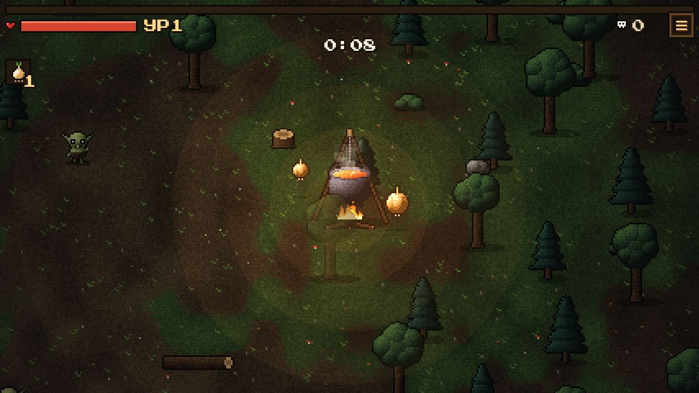
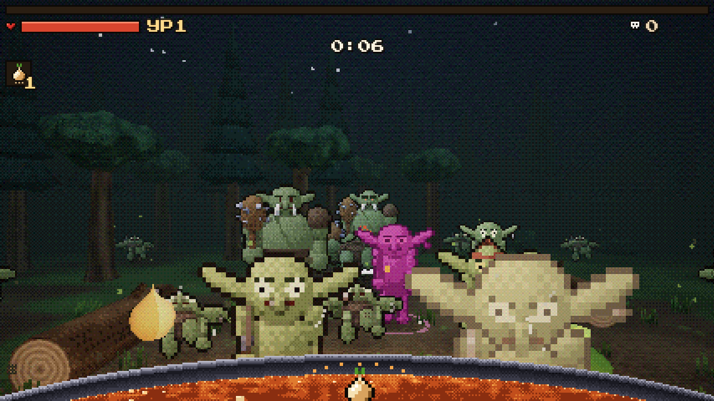

# Dark Soup

Dark Soup — пиксельная игра на выживание, в которой вам предстоит защищать котёл от лесных существ, собирать опыт и превращать обычные овощи в необычные способности

Исследуйте лес, пробуйте разные сочетания ингредиентов и узнайте, как долго сможет продержаться ваш суп

**[Играть в Dark Soup →](https://dark-soup-rho.vercel.app)**



Вас ждут волны врагов, улучшения ингредиентов, книга рецептов и статистика готовок — играть можно как на компьютере, так и на телефоне

## Управление

На компьютере:

- WASD или стрелки — движение
- Esc или P — пауза
- 1–3 — выбор улучшения
- Enter — начать игру или повторить забег после поражения

На телефоне:

- Виртуальный джойстик — движение
- Кнопки на экране — пауза, выбор улучшений и управление меню

## Секретный вид

В настройках нажмите **change** и введите четырёхзначный код, чтобы увидеть лес от первого лица

Подсказка: год начала Первой мировой войны минус 680

Повторный ввод кода вернёт привычный вид сверху



Для обзора используйте мышь — нажмите на игру, чтобы захватить курсор, а для движения используйте WASD, Q/E или стрелки помогут повернуться

На телефоне двигайтесь левым джойстиком и смотрите по сторонам с помощью правой части экрана

## Локальный запуск

Нужен Node.js 22 или новее — установка пакетов и сборка не требуются:

```sh
npm start
```

После запуска откройте [localhost:5173](http://localhost:5173)

На macOS также можно открыть файл `Запустить игру.command` — для этого понадобится Node.js или Python 3

Для проверки изменений используйте `npm test` и `npm run check`

Подробнее о проекте: [архитектура](docs/architecture.md), [режим от первого лица](docs/first-person.md) и [проверки](docs/verification.md)
